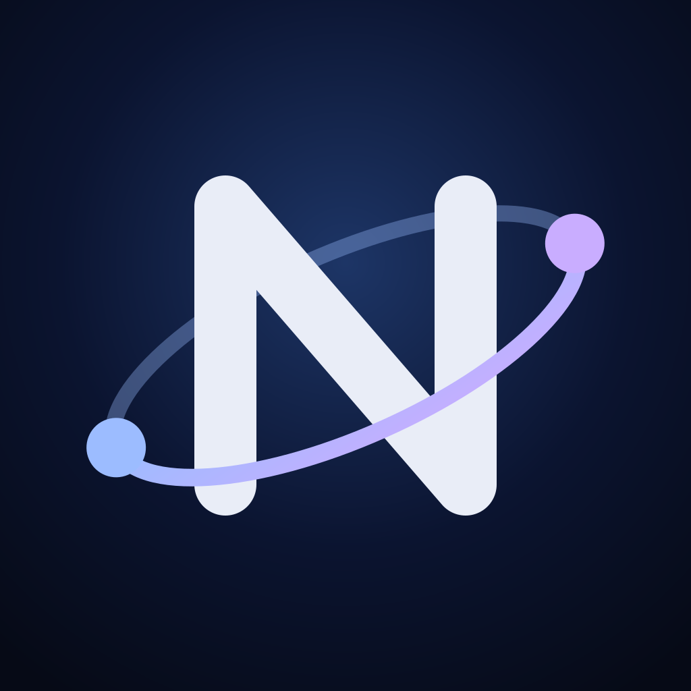

<div align="center">



# Nexus

**Your Linux home lab, in your pocket.**<br>
A native SwiftUI app for iPhone and iPad: SSH terminals, files, services, host health and an AI workspace.

[](project.yml)
[](Package.swift)
[](App)
[](docs/BUILDING.md)

[**Latest build**](https://github.com/ljcatherine/NexusiOS/releases/latest) ·
[Docs](docs/README.md) ·
[Building](docs/BUILDING.md) ·
[Configuration](docs/CONFIGURATION.md) ·
[Nexus Desktop for Windows](https://github.com/ljcatherine/NexusWindows)

</div>

---

## What the app does

| | |
|---|---|
| **SSH and terminal** | Saved device profiles with ordered LAN/Tailscale endpoints. OpenSSH Ed25519 key import and generation. Credentials and host pins in the iOS Keychain, explicit first-use fingerprint confirmation, changed-key rejection and guarded rotation. Interactive PTY tabs, reconnect, optional tmux, keyboard controls and terminal search. |
| **Overview and monitoring** | Linux CPU, memory, storage, uptime, load and GPU snapshots. History and rates derived only from matching samples, optional active-screen refresh, and opt-in local low-resource notifications. No fabricated telemetry. |
| **Files** | Remote SFTP and app-local browsing, bounded previews and edits, multi-file and recursive transfers with progress and cancellation, path safeguards and explicit conflict handling. |
| **Services** | systemd controls and logs, guarded NixOS dry-build/switch, network/DNS/TCP diagnostics, confirmed command recipes, and the **One Time Passcode** that unlocks Nexus Desktop on Windows. |
| **AI** | Native chat for NexusAI/OpenAI-compatible APIs, Open WebUI, Ollama, and Apple Intelligence on eligible iOS 26+ devices. Streaming, response profiles, protected conversations, text/CSV/TSV/XLSX/PDF and up to three image attachments, on-device OCR for scanned PDFs, opt-in local knowledge, a secret warning for outgoing text, approved sharing of cached host snapshots, and optional web research through the gateway. |

Legacy XLS workbooks are unsupported, and XLSX extraction reads bounded cell values without evaluating formulas.

> [!NOTE]
> The Cloudflare gateway, SSH relay and gateway-backed AI features need your own deployment; see [NexusBackend](https://github.com/ljcatherine/NexusBackend). AI only gets explicitly approved reads of cached host snapshots or service inventories; it never gets a shell or admin tools.

## Install a build

Each [release](https://github.com/ljcatherine/NexusiOS/releases) contains:

| Asset | What it is |
|---|---|
| `Nexus-v<version>-build.<n>-unsigned.ipa` | The **unsigned** device build, made locally with xtool |
| `…-unsigned.ipa.sha256` | Checksum for the IPA |
| `…-metadata.json` | Source commit, version and build number |

> [!IMPORTANT]
> Sign the IPA yourself before installing; the build never touches signing certificates or profiles. A successful build proves it compiles and packages, not that it installs or that live AI works. See [signing](docs/SIGNING.md), then run the [device acceptance checklist](docs/TESTING.md).

The simulator ZIP is a demo with mock data; it cannot reach private network services and does not install on a phone.

## Develop on NixOS / Linux

Verified toolchain: **Swift 6.4.1**, **xtool 1.24.0** and the **Xcode 27.1 SDK**. Apple SDKs are proprietary and not included; install a compatible local SDK as described in [Building](docs/BUILDING.md).

```sh
nix develop
./scripts/dev-doctor.sh
./scripts/test-swift.sh
./scripts/xtool-build.sh --debug
./scripts/xtool-build.sh --release --ipa   # unsigned device IPA, no iPhone or Xcode needed
```

Publish the next unsigned release (IPA, checksum and metadata) to GitHub Releases:

```sh
./scripts/xtool-release.sh
```

<details>
<summary><b>More scripts</b></summary>

```sh
./scripts/xtool-build.sh --clean --release --ipa
./scripts/xtool-simulator-build.sh --architecture arm64
./scripts/expo-dev.sh
./scripts/export-snack.sh
./scripts/test-snack-sdk54.sh
./scripts/test-expo.sh
```

</details>

To preconfigure your own gateway or AI endpoint in a build, see [Configuration](docs/CONFIGURATION.md).

## Security and host access

> [!CAUTION]
> Never put SSH private keys, passphrases, API tokens, Apple certificates or provisioning profiles in source, the IPA or CI. Never disable SSH host-key or HTTPS certificate verification, and never expose SSH, inference, Minecraft or management ports publicly to make hosted testing work.

- SSH credentials and host pins live in the iOS Keychain; API tokens are Keychain-only.
- HTTP is limited to explicitly configured private network addresses.
- The app never grants sudo or changes remote permissions. Elevated commands rely on the remote account's existing policy and need clear confirmation.
- Remote host configuration, firewall, Tailscale, Minecraft services and panel settings are not changed without explicit authorization.

**Device setup:** import the right Ed25519 key through Files, use the matching SSH username, turn on Tailscale for tailnet addresses, and verify the first-use host fingerprint out of band. SSH sessions close when the app goes to the background; reconnect when you return. See [SSH keys](docs/SSH-KEYS.md).

## Build and release policy

Device IPAs are built and validated locally with xtool. **Codemagic and GitHub Actions are not used** for builds, tests or releases. The release script publishes an unsigned IPA with checksum and metadata through GitHub CLI and never accesses signing material.

## In this repository

| Path | What it is |
|---|---|
| [`App/`](App) | The SwiftUI app |
| [`Sources/NexusCore`](Sources/NexusCore) · [`Sources/NexusSSH`](Sources/NexusSSH) | Core models and logic, SSH transport |
| [`docs/`](docs) | Build, configuration, security and testing guides |

The gateway, Cloudflare Worker, agent orchestrator, workspace agent and Hermes engine are in [ljcatherine/NexusBackend](https://github.com/ljcatherine/NexusBackend). NexusAI, the PS5 inference app, is in [ljcatherine/NexusAI](https://github.com/ljcatherine/NexusAI).

Known issues and fixes are in [troubleshooting](docs/TROUBLESHOOTING.md). Report security issues as described in [SECURITY.md](SECURITY.md).

<div align="center">
<sub>Nexus · <code>com.ljcatherine.Nexus</code> · built locally with xtool</sub>
</div>
